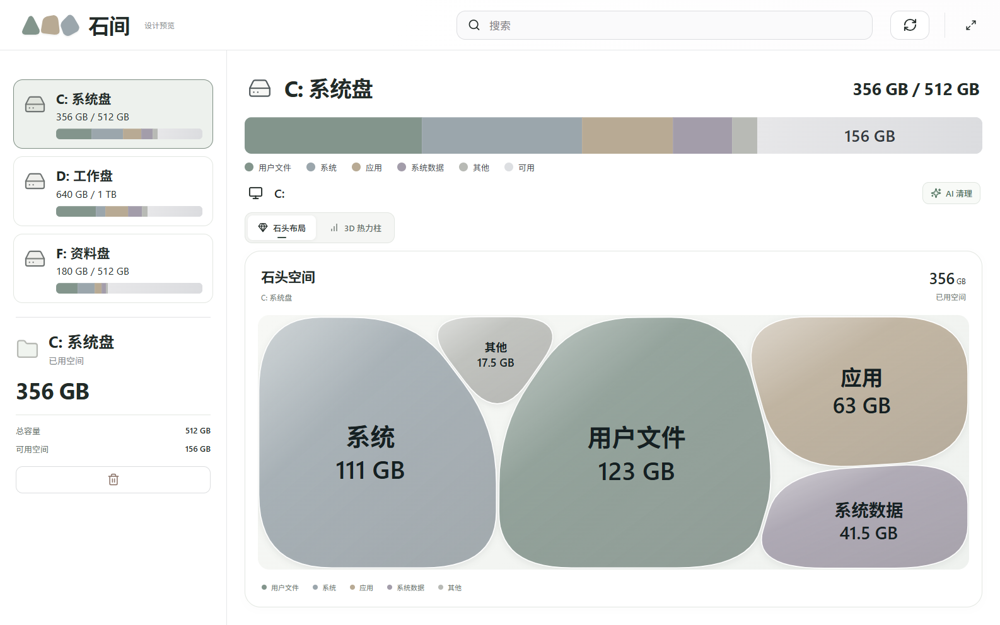
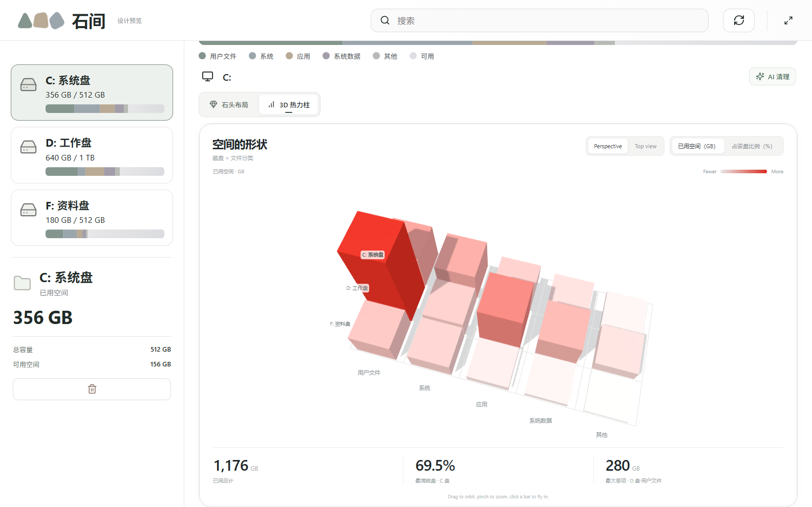

# 石间 · 磁盘空间

用石头看见磁盘空间。一个 Windows 磁盘可视化工具，以及可在线体验的交互设计网站。

**[在线体验](https://sugarvei.github.io/shijian-stone-space/)** · **[下载安装包](https://github.com/SugarVei/shijian-stone-space/releases/latest)** · **[安装说明](#windows-安装与启动)** · **[我的作品集](https://sugarvei.github.io/idea-vault/)**



## Windows 安装与启动

目前提供 **Windows x64 免安装便携版**，在 Windows 11 x64 验证运行。网页体验无需安装；扫描自己的磁盘需要下载桌面版。

1. 打开 **[Releases 下载页](https://github.com/SugarVei/shijian-stone-space/releases/latest)**。
2. 在 **Assets** 下载 **`Shijian-Windows-x64-v0.3.1.zip`**。不要下载页面自动生成的 `Source code (zip)`，那是开发源码。
3. 右键压缩包，选择「全部解压」，解压到自己的文件夹，例如 `D:\Apps\Shijian`。
4. 进入解压后的 **`石间-Windows`** 文件夹，双击 **`石间.exe`**。
5. 首次启动需要扫描一次。以后会优先读取本机缓存，需要最新结果时点击右上角「重新扫描」。

**保留完整文件夹一起使用。** 不要只复制 EXE，也不要在压缩包内部直接运行；`resources`、`locales`、DLL 等文件都是程序的一部分。无需另外安装 Node.js、Electron 或 Python。

这是未做代码签名的个人项目，Windows 可能显示发布者提示。请只使用本仓库 Releases 的文件，并可用同页的 `SHA256SUMS.txt` 核对下载完整性。

### 连接 DeepSeek（可选）

- 磁盘扫描和空间图可离线使用，不需要 API Key。
- 打开 **「AI 清理」→ 右上角齿轮「API 设置」**，输入你自己的 DeepSeek API Key，选择界面支持的模型并保存。AI 分析需要联网，并使用你自己的 API 账户额度。
- 不包含开发者或其他人的密钥。选择保存密钥时，由 Windows 加密保存在当前用户的应用配置目录。
- 仅向 API 发送候选文件的相对路径、大小、修改时间等元数据，不上传文件内容。
- AI 只给出建议；**用户手动勾选并再次确认后，才会移入回收站**。不会自动永久删除文件。

### 更新与移除

更新前退出程序，将新版本解压到一个新文件夹，再打开新版本 EXE。扫描缓存和保存的设置位于当前 Windows 用户的应用配置目录，使用同一账户启动时可继续读取。该便携版不安装服务；退出后删除程序文件夹即可移除程序，用户配置与缓存需按需另行清理。

## 网页与桌面版

| | 网页设计预览 | Windows 桌面版 |
|---|---|---|
| 数据 | 固定的磁盘 × 分类数据，合计 1,176 GB | 本机实际扫描结果 |
| 布局 | 石头布局 / 3D 热力柱切换 | 文件夹级石头布局 |
| 操作 | 选择磁盘、分类详情、3D 旋转缩放 | 真实扫描、搜索、进入文件夹、缓存 |
| AI 清理 | 演示流程，不接收 API Key | 用户配置 DeepSeek 后分析候选 |
| 删除 | 不操作本机文件 | 用户确认后移入回收站 |

网页提供 [GitHub Pages](https://sugarvei.github.io/shijian-stone-space/) 与[原在线预览](https://shijian-stone-space.twxyforl.chatgpt.site) 两个入口。网页不会扫描访问者磁盘。3D 图形需要支持 WebGL 的浏览器，并联网加载 Three.js CDN。



## 主要功能

- 不规则毛玻璃石头、流光选中边框、跟随鼠标的柔光与统一低饱和配色。
- Windows 后台扫描、磁盘切换、目录进入与返回、搜索、打开资源管理器。
- 完成的扫描写入本机缓存，下次先显示上次结果；手动刷新获取完整最新结果。
- 网页 15 根热力柱，支持 Perspective / Top view、GB / % 动画切换、悬停与点击详情、重置视角。
- 网页数据集中在 [`public/disk-heatmap.html`](public/disk-heatmap.html) 顶部的 `DATA`；分类合计与容量不一致会明确报错，不生成虚假的文件夹明细或历史变化。

## 从源码运行

需要 Node.js 24；Windows 桌面版还需要在 Windows 上构建。

```bash
git clone https://github.com/SugarVei/shijian-stone-space.git
cd shijian-stone-space
npm ci
npm run dev
```

浏览器打开开发服务器显示的 `http://127.0.0.1:5186`。运行打包桌面版：

```bash
npm test
npm run build
npm run package
```

完成后打开 `release/石间-Windows/石间.exe`。只启动当前源码的 Electron 窗口可运行 `npm start`（需先构建网页）。

推送到 `main` 后 GitHub Actions 会运行测试、构建并发布 GitHub Pages。更多扫描边界、AI 文件保护规则和测试方式见 [开发说明](docs/DEVELOPMENT.md)。
